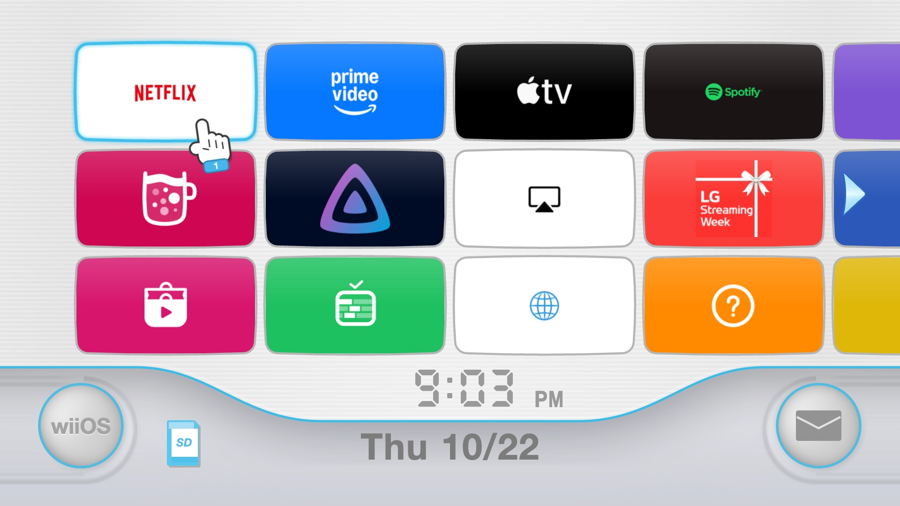
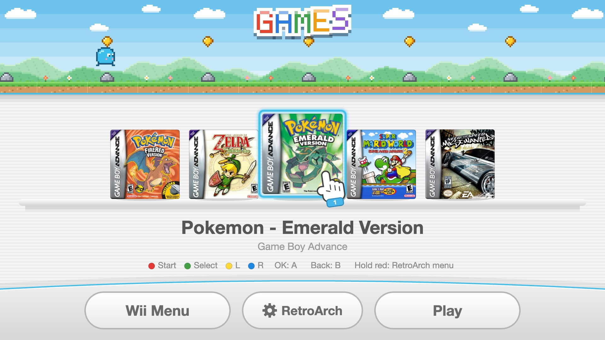

# wii-webos

The Wii channel menu on a rooted LG webOS TV: twelve channels to a page, the segment clock and the
date, the round buttons, a pointing hand that follows your selection, and the sounds. Each channel
is one of your apps.

It's a webOS port of [wii-tv](https://github.com/MauroProto/wii-tv), which does the same for
Android TVs.



> **Tested on one TV:** LG UK6950PLB, webOS 4.4.2 (2018). It's written for webOS 4's Chromium 53, so
> newer webOS versions should run it too, but they haven't been tried.

## Disclaimer

A fan project, not affiliated with or endorsed by Nintendo or LG. "Wii" is a trademark of Nintendo.
Nothing here comes from Nintendo: the menu and its icon are drawn from wii-tv's measurements, and the
sounds are wii-tv's synthesised ones.

## Requirements

- An LG webOS TV rooted with [Homebrew Channel](https://www.webosbrew.org/), and its root shell
  reachable from your computer: SSH with your key, or Homebrew Channel's telnet. The tools use SSH
  when it works and telnet otherwise.
- A computer on the same network with Python 3.7 or later (macOS, Linux or Windows). Nothing to
  install: the tools use only Python's standard library.

## Install

```sh
git clone https://github.com/Arafo/wii-webos.git
cd wii-webos
python3 tools/install.py 192.168.1.50      # your TV's IP address
```

It reads the TV's apps and inputs, packages the menu, installs it and opens it. No Developer Mode
or LG account is involved: the menu is installed the way Homebrew Channel installs apps, so it stays
installed like them. Run the same command again after changing `app/config.js` or installing apps
on the TV.

To remove it:

```sh
python3 tools/install.py 192.168.1.50 --uninstall
```

## Remote

| Key | Action |
| --- | --- |
| Arrows | Move the hand. Right from the last column turns the page; down from the bottom row goes to the buttons. |
| OK | Opens the channel or button. |
| Back | Closes the inputs menu or the notice screen. |
| Magic Remote pointer | Pointing at a channel or button selects it; clicking opens it. The blue arrows turn the page. |

The left button opens the TV's settings, the SD card opens Photo & Video (USB drives), and the
envelope lists the inputs and live TV.

## Configure

Edit [`app/config.js`](app/config.js), then run the install command again: which apps come first,
apps to hide, what the buttons open, the left button's text, sounds, the Games channel, the notice
screen and the language (English or Spanish; it follows the TV). For app ids:

```sh
python3 tools/sync.py 192.168.1.50 --list
```

## Games

The Games channel, first in the menu, plays Game Boy, Game Boy Color and Game Boy Advance games in
[RetroArch](https://github.com/webosbrew/RetroArch) with the mGBA core. Its tile is a pixel-art meadow
with a little runner; inside, your games are cartridges on a shelf: pick one and press Play (or OK).
The project ships no games: use only games you own.



1. **Set RetroArch up** (once, and again after RetroArch updates):

   ```sh
   python3 tools/games.py 192.168.1.50 --setup
   ```

   It installs RetroArch from the Homebrew Channel repository if it's missing (checking the published
   SHA-256), the mGBA core from webosbrew's core server (checking its CRC32), and a small launch script
   inside RetroArch: RetroArch's webOS port ignores launch parameters, so the script reads the game and
   core from them, which is how the menu starts a game. It also sets RetroArch up for the remote and the
   TV, keeping the old settings in `retroarch.cfg.before-wii-webos`. Re-run it after a RetroArch update,
   which replaces the script.

2. **Add your games** (`.gba`, `.gb` or `.gbc`):

   ```sh
   python3 tools/games.py 192.168.1.50 add "My game.gba" --title "My game"
   ```

   The title defaults to the file name without region tags; `--color "#E8432E"` sets the label colour.
   `--list` shows the games and `remove "My game"` takes one off (`--delete` also deletes its file). The
   menu picks up the change straight away.

   **Covers.** `add` fetches the game's box art from libretro's thumbnail server, the one RetroArch
   uses, when the file is named as in the No-Intro sets (`Game Name (USA).gba`). A game with a cover
   stands on the shelf as its box; a game without one is a pixel cartridge with a coloured label. `--cover picture.png` (or `.jpg`) uses
   your own image instead. Covers stay on your computer and TV (`app/covers/` is git-ignored): box art
   belongs to its publishers.

In a game, the remote plays as the handheld:

| Remote | Game |
| --- | --- |
| Arrows | D-pad |
| OK | A |
| Back | B (a tap: the webOS port can't hold it) |
| Red, Green, Yellow, Blue | Start, Select, L, R |
| Hold red for two seconds | RetroArch's menu (save, load, quit) |

In-game saves reach the file within ten seconds. Threaded video is on: without it the sound crackles on
a webOS 4 TV.

## Your own sounds

The menu plays wii-tv's synthesised sounds. To use your own, put WAV files in `app/sounds/custom/`
named after the event they're for, and install again:

| File | Plays when |
| --- | --- |
| `move.wav` | the focus moves to another channel or button |
| `page.wav` | the page turns |
| `select.wav` | a channel or button opens |
| `menu.wav` | the inputs menu opens |
| `back.wav` | Back closes the inputs menu |
| `start.wav` | OK is pressed on the notice screen |

Any event without its file plays the built-in sound. To use other file names, change `soundFiles`
in `app/config.js`. The folder is git-ignored, so your sounds stay on your computer.

## How it works

- **Channels.** wii-tv uses each Android app's own TV banner. webOS apps have none, so each channel
  is the app's colour, read off the edge of its icon (else LG's `iconColor`), with the logo large
  in the middle.
- **App list.** A webOS app can't list the installed apps, so `tools/sync.py` reads them, their
  icons and the inputs from the TV's root shell into `app/apps.js` at install time.
- **Speed.** webOS 4's browser is slow at compositing. Nothing is painted while things move: the
  channels are painted once, one canvas per page (a canvas per channel cost 30-50 ms a frame), the
  focus glow is a pre-painted overlay that fades, and the hand, page scroll and button zoom are CSS
  transitions. The backdrop and button body are images rendered from wii-tv's `WiiBase` and
  `WiiPalette`, as computing them per pixel would take seconds on the TV.
- **Sound** goes through Web Audio: each `<audio>` element would claim one of the TV's few
  hardware audio decoders.

## Limitations

- It's an app you open from LG's launcher. It doesn't take over the Home button or start with the TV.
- The Mii channel from wii-tv isn't ported, and the Games channel's meadow holds still.
- Text is in English and Spanish only.

## Files

| File | What it does |
|---|---|
| [`app/`](app/) | The menu: `index.html`, `style.css`, `wii.js`, `config.js`, `appinfo.json`, images and sounds |
| [`tools/install.py`](tools/install.py) | Reads the TV's apps, packages the .ipk, installs and opens it, or removes it |
| [`tools/sync.py`](tools/sync.py) | Reads apps, icons and inputs from the TV into `app/apps.js` and `app/icons/` |
| [`tools/games.py`](tools/games.py) | Sets RetroArch up for the Games channel and adds, lists and removes games |
| [`tools/tv.py`](tools/tv.py) | Runs commands on the TV as root and moves files over HTTP |

## Credits and licence

- [wii-tv](https://github.com/MauroProto/wii-tv) by MauroProto (MIT): the menu's design, geometry,
  colours, drawing and synthesised sounds, ported from `WiiMenuView`, `WiiBase` and `WiiPalette`; the
  Games channel's pixel art, shelf and remote layout, from `PixelArt`, `PixelScene`, `GamesView` and
  `tools/games/add.py`.
- [RetroArch for webOS](https://github.com/webosbrew/RetroArch) by webosbrew (GPLv3), installed
  separately; it isn't part of this repository.
- [cleanyourtv](https://github.com/Gathin23/cleanyourtv) by Gathin (MIT): the base wii-tv is built on.
- [webos-vibehack](https://github.com/OmkarK97/webos-vibehack) by OmkarK97 (MIT): the approach for
  webOS, reading apps from a computer and calling the luna bus from a web app.
- MIT licence: see [LICENSE](LICENSE).
